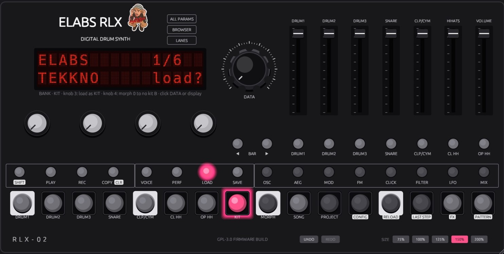
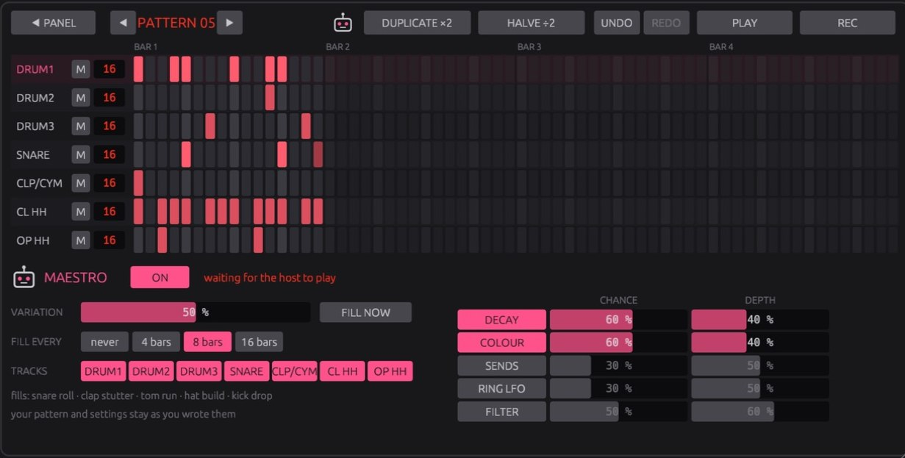
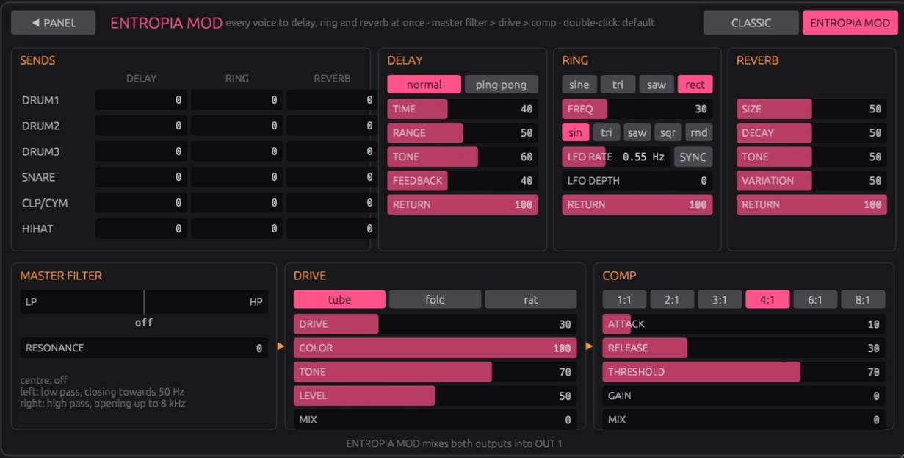
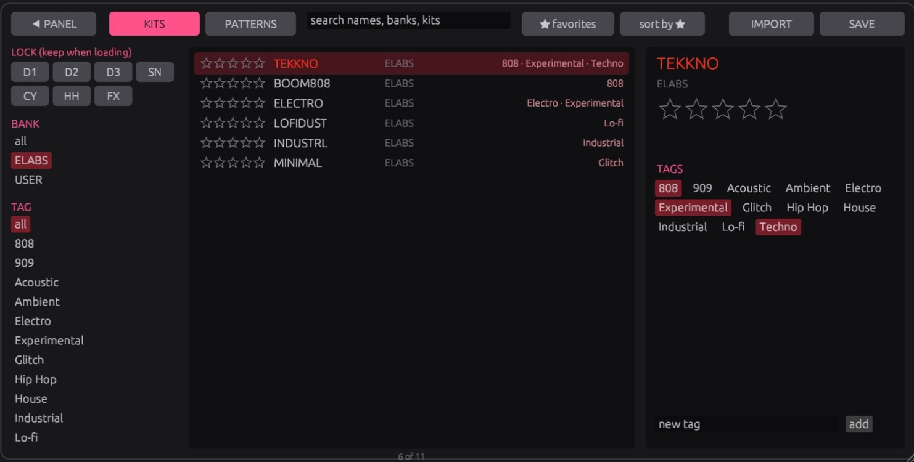

# ELABS RLX

**The LXR-02 drum engine as a free VST3 for macOS (Apple Silicon and Intel).** It isn't an emulation:
it's the open-source LXR V2 firmware's own C sound engine and sequencer, compiled for the Mac and
wrapped in a panel laid out like the hardware. Made by EntropiaLabs.



- six synthesized drum voices (three drums, snare, clap/cymbal, hi-hats) with FM, transient clicks,
  filters, LFOs, velocity modulation and kit morphing
- the hardware's step sequencer synced to the DAW: 64 patterns of 7 tracks, parameter locks,
  probability, flams, euclidean patterns, shuffle, song mode and a LANES view that edits every step
- **ENTROPIA MOD**: per-voice sends to delay, ring modulator and reverb, then a master filter,
  drive and compressor
- **the Maestro**: plays your pattern like a drummer, with variations, fills and moves on decays,
  sends, LFO and filter
- kits and patterns in the LXR-02's own .SND / .PAT formats; Erica Synths' free factory content
  imports straight from their zips (BROWSER > IMPORT)
- 11 kits and 7 patterns by EntropiaLabs built in, a preset browser with stars and tags, undo/redo,
  a resizable panel and any number of instances

**Download:** the installer is on the [Releases](../../releases) page. macOS 11 or newer, any VST3
host (built and tested in Ableton Live 12). The installer isn't signed with a paid Apple
certificate, so macOS asks once: right-click the .pkg > Open.

| | |
|---|---|
|  |  |
|  | |

## How it's built

Formerly ELABS LXR; the VST3 class id is unchanged, so sets made with the old name still load it.

The LXR V2 drum engine (Erica Synths, GPL-3.0 firmware from
[erica-synths/lxr-desktop-app](https://github.com/erica-synths/lxr-desktop-app)) running as a VST3
instrument on macOS. The firmware's sound engine is compiled from `engine/firmware` (commit in
`engine/FIRMWARE_COMMIT`), changed only by the bounds fixes and two small hooks in `engine/patches`; `engine/shim`
replaces the STM32 HAL and `engine/lxr_bridge.c` drives the engine the way the LXR's front panel does.
## Build and install

```sh
cargo xtask bundle elabs_lxr --release
cp -R "target/bundled/ELABS RLX.vst3" ~/Library/Audio/Plug-Ins/VST3/
```

Release build, one plugin for Apple Silicon and Intel (needs `rustup target add
x86_64-apple-darwin`), packed into an installer for `/Library/Audio/Plug-Ins/VST3`:

```sh
tools/make_installer.sh        # dist/ELABS RLX <version>.pkg
```

The package is unsigned unless `SIGN_ID` names a Developer ID Installer certificate; unsigned, macOS
asks to confirm it on first open (right click > Open).

## MIDI

| Channel | Notes | Plays |
|---|---|---|
| 1 | 36-42 (C1-F#1) | Drum 1, Drum 2, Drum 3, Snare, Cymbal, Hihat closed, Hihat open |
| 2-8 | any | the same 7 triggers chromatically, note 60 = programmed pitch |

## Panel

Laid out like the LXR-02 front panel (without the manufacturer logos):

- the LCD shows four parameters of the selected voice and sub page, exactly as the firmware's
  menu pages define them; the selected one is in capitals and its full name is shown below
- the four knobs edit those four; DATA edits the selected one in single steps
  (drag, scroll wheel, double-click resets)
- DRUM1 ... OP HH next to the faders select the voice, OSC ... MIX the sub page; press a sub page
  again (or use the BAR arrows) for its second row of parameters
- pads 1-7 play the voices and light up when a voice is triggered (also from MIDI); FX opens the
  master FX page, which follows the FX type
- faders: voice levels and master volume

`cargo run --release --features preview --bin lxr_preview` opens the panel as a standalone app.

## Kits

Six ELABS kits are built in (bank **ELABS**): TEKKNO, BOOM808, ELECTRO, LOFIDUST, INDUSTRL and
MINIMAL, each the firmware's init kit with its own settings, with one pattern each in the ELABS
project. They are written by `src/elabs_kits.rs` (`cargo test --release --lib write_elabs_content
-- --ignored --nocapture` tunes the drums by measuring them, writes `kits/elabs/ELABS` and renders
`target/elabs_kits_demo_48k.wav`). Five EntropiaLabs kits made on the panel follow in the same bank
(NTRPBT1, CHAPA, CONCRETO, FERRUGEM, MADRUGA), with the ENTROPIA project's pattern, in
`kits/elabs/ENTROPIA`. `tools/gen_kits.py` and `tools/gen_projects.py` pack `kits/elabs` into
`kits/lxr_kits.bin` / `kits/lxr_projects.bin`. The built-in kits come tagged (`BUILT_IN_TAGS` in
`src/favorites.rs`) until the user changes their tags; a library kit with a built-in kit's sound is
listed once.

The LXR-02 factory content and Erica Synths' sound packs are not built in. They are free
downloads on the LXR-02 product page; the browser's **IMPORT** button takes them as they come
(zip or unzipped folder) and copies their kits and projects into the library under `Imported/`
(the factory card shows up as bank FACTORY with projects FACTORY 1-6, the packs as HRTL DLC and
UNTZKITS).

### Window, LANES, help

- **SIZE** (bottom right) or the corner handle resizes the window, 50-250 %, keeping the panel's
  proportions; the size is saved with the session. The panel is drawn at its base size on a
  scaled egui layer (egui-baseview ignores egui's zoom factor); `vendor/nih_plug_egui` makes the
  resize request public and fixes two resize bugs (see `vendor/README.md`)
- **LANES**: all seven tracks of the shown pattern, 64 steps; click, drag to paint, right-click or
  ⌘-click to edit a step; per lane mute and length; brightness = velocity; **DUPLICATE ×2** /
  **HALVE ÷2** double or halve the pattern (see COPY/CLR)
- LANES **detail strip**: click a lane (or its name) and edit that track's steps as bars, like a
  DAW's velocity lane: VELOCITY, PROB, NOTE (±2 octaves), RATCHET (the firmware's flam x2-x8),
  SHIFT (micro timing) and LOCK 1/2 (parameter locks; ◀ ▶ pick the parameter). Drag to draw,
  right-click resets a step, RESET clears the whole lane. Only steps that are on are drawn
  (`src/editor/lane_detail.rs`)
- **MAESTRO** (the little robot in the LANES header): plays the pattern a little differently
  every bar, after the ELABS Liveset Player's Maestro. VARIATION: velocities breathe (the kick
  only ±6, never moved), closed-hat ghosts and ratchets, an off-beat open hat, snare/clap ghost
  notes, percs moving a sixteenth. FILL EVERY 4/8/16 bars (or FILL NOW): a fill on the last
  beat of the phrase (snare roll with rising ratchets, clap stutter, tom run on DRUM2/3, hat
  build, kick drop), never the same one twice in a row. MOVES, each with its own switch, CHANCE
  (how many bars, or for the filter how many fills) and DEPTH (how far): DECAY (hat and snare
  decays), COLOUR (hat/snare/cymbal filters, snare noise, cymbal and perc decays; no pitch,
  nothing of the kick), and in ENTROPIA MOD SENDS (a voice thrown into the delay or reverb for a
  bar, the snare or clap at fills), RING LFO (rate or note length, depth, now and then the wave)
  and FILTER (a master filter sweep over the fill, high pass rising or low pass closing, back on
  the downbeat; other bars only now and then a short one). Turn a setting and that's the new
  centre. TRACKS picks what it may touch. It plays a varied copy in the engine: your
  pattern is never changed, and it pauses (and gives everything back) while REC is on. The
  variation goes in on each bar's first beat, a fill on its third (`src/maestro.rs`; settings
  saved with the session)
- **UNDO / REDO** (footer and LANES, also ⌘Z / ⇧⌘Z when the host passes the keys on): every
  click, drag or run of scrolling is one step (sound, kits, patterns, mutes, song; up to 100);
  only what the step changed is put back, so automation and REC recording are left alone
  (`src/editor/history.rs`)
- the ELABS logo (Entropia sticker, `assets/logo.png`, from the StageDeck/Gig Manager icon) sits
  where the LXR-02 has its mascot; the panel follows the unit's look: black scalloped DATA knob,
  light knob caps, round step caps in square bezels with the beats (1, 5, 9, 13) on white bezels, pink LEDs,
  second-function labels in white boxes
- hovering any control explains it; turning a knob or fader shows its name and value next to it
- the browser's **LOCK** buttons keep voices (and the FX) when a kit is loaded, also when a
  pattern brings its kit

### Browser

Clicking the display on a voice or FX page (or the BROWSER button) opens a browser with every kit
and every pattern: search, filter by bank/project, by tag or by favorites, sort by stars, and click
to load (a pattern brings its kit). Its **SAVE** button saves from there: on KITS the current sound
as a kit, on PATTERNS the shown pattern with the sound you hear (added to the project folder you
name, in its first free slot) or the whole session as a project. Star ratings (1-5) and tags (preset ones like Techno, 808, Lo-fi
plus your own) are kept in `~/Music/ELABS RLX/favorites.tsv`, so they hold across all sessions;
items are keyed by name and a hash of their contents.

### Library folder

`~/Music/ELABS RLX` works like the LXR-02's SD card, so unzipped LXR-02 downloads can be dropped in
as they are:

- every `.SND` kit in it shows up in the kit browser, one bank per folder (`Kits/` is bank USER)
- every folder with `.PAT` files is a project (64 patterns + the `NN-NAME.SND` kits they name) and
  shows up in the PATTERN browser after the built-in ones

**SAVE** saves in the hardware's formats: KIT writes the current sound to `Kits/NAME.SND` and into a
kit slot of the session's project (the shown pattern then uses that kit); PROJECT writes the
session's patterns and project kits to `Projects/NAME/` (`NN-.PAT`, `NN-NAME.SND`). Type the name
in the field under the display (it opens selected, Enter saves) or edit it on the display: knob 3
moves the cursor, knob 4 or DATA change the letter.

**IMPORT** (browser top bar) copies LXR-02 content into the library: choose a zip (as downloaded
from Erica Synths) or a folder. Only `.SND` and `.PAT` files are copied, to `Imported/NAME/`
(Erica's factory zip becomes FACTORY, Sound Pack 1 HRTL DLC, Sound Pack 2 UNTZKITS). Kits with the
same sound as one already listed and empty INIT kits are skipped; patterns without steps are left
out of the PATTERN browser. SHOW THE LIBRARY FOLDER opens `~/Music/ELABS RLX` in Finder.

### Morph

On the LOAD page, knob 3 switches between loading a kit and loading it as the morph kit B; knob 4
(or the `Morph` parameter) morphs 0-255 from the kit towards kit B with the firmware's
`interpolate()`, so it never fully reaches B, like the hardware. Audio outputs and modulation
destinations don't morph. Kit B is saved with the session.

User samples aren't part of this firmware (its sample oscillator code is compiled out), so there
are none here either.

## Sequencer

The firmware's own step sequencer (`sequencer.c`), clocked by the host: 96 ticks per beat from
Live's musical position, with the pattern's shuffle, re-aligned after loops and jumps (the steps
before the play position are skipped silently, so a pattern sits on the host's bar grid).

- **PLAY** (or the `Sequencer` parameter) turns it on; it plays while the host transport runs
- the 16 step buttons then edit the selected voice's track (CL HH / OP HH are separate tracks);
  the white frame is the playing step; **BAR** ◀ ▶ picks which of the 4 bars they show
- **SHIFT** latches the buttons' printed functions (pads, KIT, FX, PATTERN)
- **PERF** opens the euclid generator and shuffle: `len` `stp` `rot` (1-16, 1-length, 0-15) for the
  track picked with the voice buttons, regenerating its steps and length as the LXR's euclid page
  does (a Rust port of `EuklidGenerator.c`, checked against the firmware for all 2416 settings),
  and `shf`, the shown pattern's shuffle (0-127: every second step up to 2/3 of a step late)
- **right-click** (or ⌘-click) a step to edit it: velocity / note / probability, flam / shift, and
  two parameter locks (destination + value), the LXR's step edit views, switched with ◀ ▶
- **REC** records pads and MIDI notes into the playing pattern, quantised to the nearest step
- **SHIFT + a voice button** mutes that track ("MUTE" shows above it)
- **COPY/CLR**: clear the track or the pattern, copy the pattern to another slot, copy the track
  to another track, or double (`dbl pat`: every track twice as long, its steps repeated; tracks
  over 32 steps stay) or halve (`hlf pat`: the steps after the new end are kept) the pattern
- **SONG** (with SHIFT): the firmware's song mode, a list of up to 63 patterns played in order, then
  looping or stopping
- the MIX page's `len` is the track's length (1-64 steps) in the shown pattern
- **PATTERN** opens the browser: knob 1 project, knob 2 pattern (1-64), DATA scrolls patterns,
  click DATA or the display to play it (at the end of the playing pattern while running). Knob 3
  (click) switches "kit follows pattern": the pattern's kit is loaded when the sequencer reaches it
  (while the panel is open)

Projects: the built-in ELABS project and every project in the library (saved, imported or
dropped in), 64 patterns each, with the kit each pattern names. Patterns are saved in the Live
set. Step velocity, probability, note, flam, shift and per-step automation from imported patterns
play back.

## ALL PARAMS

The ALL PARAMS button shows every parameter of a voice (or FX/master) at once, in the order of the
menu pages. With Live's **Configure** on, touching a control there adds it to the device panel, where
Live can MIDI-map it.

## ENTROPIA MOD FX

The LXR has one FX bus that runs one effect at a time, chosen by the kit (CLASSIC). ENTROPIA MOD is
a modification of it: the FX page has an **FX MODE** switch, and **ENTROPIA MOD** opens a page of
its own (the FX button goes there while it is on) where

- every voice has a **send** to a **DELAY** (normal / ping-pong), a **RING** modulator and a
  **REVERB**, each with its settings and a RETURN level, all running at once;
- the ring's frequency has an **LFO** (sine / tri / saw / square / random, 0.05 to 20 Hz, depth up
  to ±3 octaves around FREQ; depth 0 is off); **SYNC** puts it on the host's tempo in note lengths
  (4 bars to 1/32, dotted and triplets) and locks it to the song position while the host plays;
- the whole mix then goes through a **MASTER FILTER** (centre off, left a low pass closing to 50
  Hz, right a high pass opening to 8 kHz, with resonance), **DRIVE** (tube / fold / rat) and
  **COMP**; DRIVE and COMP start with MIX at 0 (off).

The effects are the firmware's own (the reverb is in the firmware but switched off on the
hardware); only the filter and the ring LFO are new (`engine/lxr_entropia.c`). Everything is a
plugin parameter, automatable and saved with the session; kits are untouched, so they still load
on the hardware. In ENTROPIA MOD both outputs are mixed into Out 1 and the kit's own FX bus is
bypassed. Bars: drag or scroll, double-click (or right-click) for the default, so the filter goes back to off. ALL PARAMS' FX tab has the same
CLASSIC / ENTROPIA MOD switch and shows the settings of the mode that is on.

## Outputs

`Out 1` is the main stereo output and `Out 2` an extra stereo output, matching the LXR's two
stereo outs (each voice's `Output` parameter routes it). If the host only uses the main output,
Out 2 is mixed into it.

## Parameters

215 sound parameters (all voices, LFOs, filters, transients, master FX) with the LXR's value ranges
and names, plus a volume fader per voice. Defaults are the firmware's init kit.
`src/param_table.rs` and `src/ui_pages.rs` are generated from the firmware tables by `tools/gen_params.sh`.

## Not done yet

- roll

## Several instances

The firmware keeps its state in C globals, so the engine is built as its own dylib (`build.rs`),
embedded in the plugin, and every instance loads a private copy of it from
`$TMPDIR/ELABS RLX/engine-<pid>-<n>.dylib` (removed again when the instance closes). Each copy has
its own globals, so any number of instances play independently.

## Tests

- `cargo test --release --lib`: renders at 48 kHz, checks pitch against the native 44.14 kHz rate
  and that parameter changes reach the engine; writes `target/lxr_demo_48k.wav`
- `engine/test/param_sweep.sh`: every parameter through its whole range, every built-in kit and
  4 bars of every project pattern, under AddressSanitizer; writes nothing
- the engine test also renders `target/lxr_kits_demo_48k.wav`, a beat on four of the kits, and
  `target/lxr_sequencer_demo_48k.wav` (ELABS pattern 1 through the host-synced sequencer); it
  checks that every built-in pattern survives a round trip through the firmware byte for byte, that
  the euclid port matches the firmware, and that full shuffle moves every second step 2/3 late

## Firmware patches

`engine/patches` holds the only changes to the firmware sources: accesses past the end of a buffer
that go unnoticed on the STM32 but can hit unmapped memory or produce NaN on a Mac, and the two
hooks ENTROPIA MOD needs:

- `0001`: `diode()` in the master FX distortion read `table_1n914[257]` when the signal clips at 1.0
- `0002`: the saw/tri/rect wavetables get a zero guard row, because the oscillators' interpolation
  reads one sample past the last row
- `0003`: switching the master FX delay from normal to ping-pong while it runs left the buffer
  positions in the whole buffer, and ping-pong wrote up to 22 KB past its end (this crashed Live,
  e.g. when loading a ping-pong kit after one with a normal delay)
- `0004`: the mixer hands each voice's block to the bridge (`lxr_voice_block`), for the ENTROPIA
  MOD sends
- `0005`: a reverb can be given its own buffer (the firmware's shares the FX RAM with the delay;
  ENTROPIA MOD runs both)

## Licence

GPL-3.0-only, like the firmware ([LICENSE](LICENSE)). "Erica Synths" and "LXR" are trademarks of
Erica Synths; ELABS RLX is an independent, unofficial build. The built-in ELABS kits are its own;
Erica Synths' and Hrtl's content isn't included and is imported by the user from their downloads.
